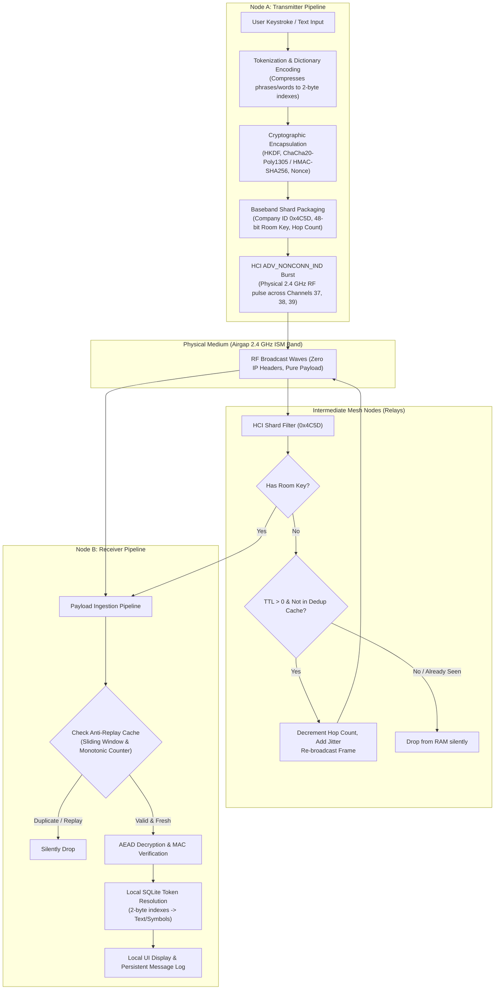

# TrackOn Chat: Technical Architecture & Implementation Blueprint
**Document Version:** 1.0.0-PROD  
**Classification:** Open Hardware & Cryptographic Protocol Specification  
**License:** MIT License (TrackOn Contributors)  

---

## 1. System Architecture & Topology

TrackOn Chat is a serverless, peer-to-peer, airgapped physical mesh transport layer that operates entirely over unbonded BLE advertising channels (`ADV_NONCONN_IND`). It operates without IP routing, cellular towers, Wi-Fi networks, SIM cards, or central servers.



---

## 2. Packet Anatomy & Frame Budget (31-Byte BLE Legacy Limit)

Legacy BLE Advertisements allow a maximum payload of **31 bytes** in the PDU data field. TrackOn Chat frames utilize every single byte deterministically:

| Offset (Bytes) | Field Name | Size | Purpose & Specification |
|---|---|---|---|
| `0..2` | **GAP Flags** | 3 B | `02 01 06` (Flags length 2, Type 0x01 Flags, Value 0x06: LE General Discoverable, BR/EDR Not Supported). |
| `3..4` | **AD Structure Header** | 2 B | Length `0x1A` (26 bytes follow), Type `0xFF` (Manufacturer Specific Data). |
| `5..6` | **Company Identifier** | 2 B | `0x5D, 0x4C` (Little-endian `0x4C5D`). Hardware silicon baseband filter. |
| `7..12` | **Room ID** | 6 B | 48-bit cryptographic channel address: $\text{HKDF-Extract}(RoomSecret, \text{"room-id"})[0..5]$. |
| `13` | **Mesh Control Header** | 1 B | `[Bits 7..4: Protocol Version (0x1)]` \| `[Bits 3..0: Hop Limit / TTL (max 7 hops)]`. |
| `14..17` | **Epoch / Sequence Counter**| 4 B | 32-bit monotonic sequence counter + coarse 15-minute epoch to prevent replay attacks. |
| `18..25` | **Ciphertext / Tokens** | 8 B | Up to 4 tokenized words/characters (4 $\times$ 2 bytes) or encrypted block. |
| `26..29` | **Authentication Tag (MAC)**| 4 B | Truncated Poly1305 / HMAC-SHA256 authentication tag over headers and ciphertext. |
| `30` | **Reserved / CRC Seed** | 1 B | Error-checking parity or routing flag. |
| **Total** | | **31 B** | **Strict adherence to Bluetooth 4.0/5.0 broadcast specification.** |

---

## 3. Cryptographic Protocol & Key Management

### 3.1 Key Derivation Tree (HKDF-SHA256)
When a room is created or joined via a passphrase / QR code / shared secret:
1. **Master Secret ($MS$):** 256-bit entropy generated from passphrase via Argon2id or raw 32-byte secret.
2. **Room ID ($RID$):**
   $$\text{PRK} = \text{HKDF-Extract}(\text{salt}=\text{"trackon-mesh-v1"}, \text{IKM}=MS)$$
   $$\text{Room ID} = \text{HKDF-Expand}(\text{PRK}, \text{info}=\text{"room-id-48bit"}, \text{len}=6)$$
3. **Encryption Key ($K_{enc}$):**
   $$K_{enc} = \text{HKDF-Expand}(\text{PRK}, \text{info}=\text{"aead-encryption-key"}, \text{len}=32)$$
4. **Authentication Key ($K_{auth}$):**
   $$K_{auth} = \text{HKDF-Expand}(\text{PRK}, \text{info}=\text{"mac-authentication-key"}, \text{len}=32)$$

### 3.2 Anti-Replay & Freshness Protection
Because airgapped nodes lack real-time NTP clocks, TrackOn Chat uses a dual mechanism:
1. **Coarse Epoch Window:** A 12-bit sliding epoch based on local RTC (15-minute resolution). Tolerates clock skew within $\pm 2$ hours.
2. **20-bit Monotonic Sender Sequence Counter:**
   - Each sender increments counter for every transmission.
   - Receivers maintain a sliding bitmask window (size 64) per sender/room in SQLite. Any packet with counter $\le \text{last\_seen} - 64$ or already marked in the bitmask is dropped without invoking decryption.

---

## 4. State & Storage Schema (SQLite)

Local databases run locally with strict file-level encryption using SQLCipher or local AES key derivation.

```sql
-- 1. Cryptographic Rooms & Channels
CREATE TABLE IF NOT EXISTS rooms (
    room_id BLOB PRIMARY KEY,            -- 6-byte binary Room ID
    room_name TEXT NOT NULL,             -- Friendly display name
    shared_secret BLOB NOT NULL,         -- 32-byte master secret
    enc_key BLOB NOT NULL,               -- 32-byte derived encryption key
    auth_key BLOB NOT NULL,              -- 32-byte derived auth key
    created_at INTEGER NOT NULL,
    is_active INTEGER DEFAULT 1
);

-- 2. Local Token / Dictionary Mapping
CREATE TABLE IF NOT EXISTS token_dictionary (
    token_id INTEGER PRIMARY KEY,        -- 2-byte integer (0x0000 - 0xFFFF)
    symbol_type TEXT NOT NULL,           -- 'CHAR', 'WORD', 'EMOJI', 'PHRASE', 'COMMAND'
    representation TEXT NOT NULL UNIQUE  -- 'w', 'hello', 'ack', 'sos'
);

-- 3. Received & Sent Messages
CREATE TABLE IF NOT EXISTS messages (
    id INTEGER PRIMARY KEY AUTOINCREMENT,
    room_id BLOB NOT NULL,
    direction TEXT NOT NULL,             -- 'IN', 'OUT', 'RELAY'
    sequence_id INTEGER NOT NULL,
    raw_payload BLOB NOT NULL,
    decoded_text TEXT NOT NULL,
    rssi INTEGER,
    timestamp INTEGER NOT NULL,
    status TEXT NOT NULL,                -- 'DELIVERED', 'SEEN', 'FAILED'
    FOREIGN KEY(room_id) REFERENCES rooms(room_id)
);

-- 4. Anti-Replay & Relay Deduplication Cache (Pruned periodically)
CREATE TABLE IF NOT EXISTS relay_dedup_cache (
    packet_hash BLOB PRIMARY KEY,        -- 8-byte hash of (room_id + seq_id + ciphertext)
    first_seen INTEGER NOT NULL,
    hop_count INTEGER NOT NULL
);

-- 5. Sender Sequence State
CREATE TABLE IF NOT EXISTS peer_sequence_tracker (
    room_id BLOB NOT NULL,
    sender_pubkey_hash BLOB NOT NULL,
    highest_seq INTEGER NOT NULL,
    sliding_window_mask INTEGER NOT NULL, -- 64-bit mask for out-of-order delivery
    PRIMARY KEY(room_id, sender_pubkey_hash)
);
```

---

## 5. Mesh Relay & Gossip Protocol Rules

1. **Blind Routing (Zero-Knowledge Forwarding):**
   - When a node receives an advertisement with Company ID `0x4C5D`:
     - Calculate `packet_hash = Blake3(payload)[0..7]`.
     - Query `relay_dedup_cache`. If present $\to$ **DROP**.
     - Check if `room_id` exists in `rooms`. If yes $\to$ forward to local Decryptor.
     - Inspect byte 13: `Hop Count = (ctrl_byte & 0x0F)`.
     - If `Hop Count > 1`:
       - Store `packet_hash` in `relay_dedup_cache`.
       - Decrement Hop Count: `new_ctrl_byte = (ctrl_byte & 0xF0) | (Hop Count - 1)`.
       - Schedule re-broadcast with randomized jitter: $T_{delay} = \text{Uniform}(40\text{ms}, 160\text{ms})$.
     - Else: Drop (TTL expired).

2. **RF Congestion Prevention:**
   - Max 3 re-transmissions per packet cluster across all mesh relays.
   - Channel hopping: Transmission cycles sequentially across primary 2.4 GHz advertising channels: 37 (2402 MHz), 38 (2426 MHz), 39 (2480 MHz).

---

## 6. Directory Layout for `TrackOn Chat`

```text
TrackOn Chat/
├── Cargo.toml / pyproject.toml      # Build & dependency definitions
├── README.md                        # Architecture & verification guide
├── LICENSE                          # MIT Open Source License
├── docs/
│   ├── PROTOCOL_SPEC.md            # Byte-level physical layer breakdown
│   ├── CRYPTOGRAPHY.md             # HKDF & ChaCha20 implementation details
│   └── MESH_TOPOLOGY.md            # Gossip & routing proofs
├── src/
│   ├── __init__.py
│   ├── core/
│   │   ├── crypto.py               # HKDF, ChaCha20-Poly1305, MAC validation
│   │   ├── frame.py                # Raw 31-byte packet pack/unpack logic
│   │   └── tokens.py               # 2-byte dictionary compression engine
│   ├── db/
│   │   ├── schema.py               # SQLite schema & database migrations
│   │   └── storage.py              # Repository for rooms, messages, dedup
│   ├── radio/
│   │   ├── broadcaster.py          # Low-level HCI ADV_NONCONN_IND transmitter
│   │   ├── sniffer.py              # Real-time raw socket / btmon HCI listener
│   │   └── rfkill_manager.py       # Auto-unblock & adapter health watchdog
│   ├── mesh/
│   │   ├── router.py               # Hop-decrementing, jitter, & blind relaying
│   │   └── anti_replay.py          # Sliding-window monotonic sequence tracker
│   └── service.py                  # Daemon coordinator & public API
└── tests/
    ├── test_crypto.py              # Unit tests for key derivation & tampering
    ├── test_frame.py               # Binary pack/unpack assert tests
    └── test_loopback_e2e.py        # End-to-end send/receive loopback test
```
